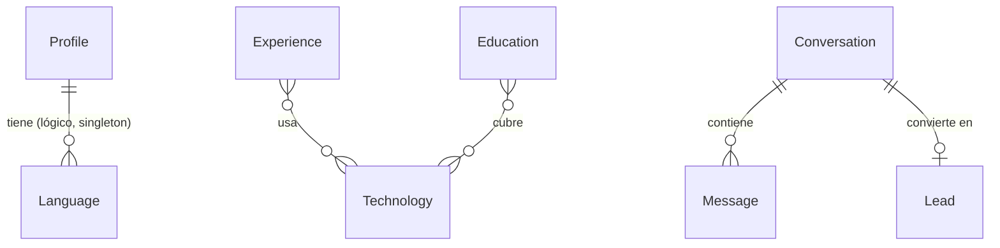

# Modelo de datos

PostgreSQL (Neon) vía Prisma 7. Dos dominios independientes: **CV** (lo edita el dueño) y **Chat** (lo generan los visitantes).

## Diagrama

> `Language` no necesita FK a `Profile`: el perfil es singleton, así que todo idioma pertenece al único perfil. Se expone dentro de `GET /profile`.

## Enums

| Enum            | Valores                                                           | Usado en                                     |
| --------------- | ----------------------------------------------------------------- | -------------------------------------------- |
| `WorkMode`      | `REMOTE`, `HYBRID`, `ONSITE`                                      | `Profile.workModes[]`, `Experience.modality` |
| `TechCategory`  | `BACKEND`, `FRONTEND`, `ARCHITECTURE`, `TESTING`, `TOOLING`, `AI` | `Technology.category`                        |
| `SkillLevel`    | `BASIC`, `INTERMEDIATE`, `ADVANCED`, `EXPERT`                     | `Technology.level`                           |
| `EducationType` | `DEGREE`, `CERTIFICATION`, `COURSE`                               | `Education.type`                             |
| `LanguageLevel` | `NATIVE`, `PROFESSIONAL`, `INTERMEDIATE`, `BASIC`                 | `Language.level`                             |
| `MessageRole`   | `USER`, `ASSISTANT`                                               | `Message.role`                               |

Los valores de los enums van en inglés por consistencia. El "INTERMEDIO" del seed es `INTERMEDIATE`. Se importan desde `src/generated/prisma/enums` para escribir los schemas Zod a mano (`z.enum(SkillLevel)`).

## CV

Todos los modelos de CV llevan `id` (cuid), `createdAt` y `updatedAt`. Los timestamps son **solo admin**.

### Profile (singleton)

| Campo          | Tipo         | Notas                                                                      |
| -------------- | ------------ | -------------------------------------------------------------------------- |
| `id`           | `Int`        | Siempre `1`. Upsert por `id = 1`; migración con `CHECK (id = 1)`           |
| `fullName`     | `String`     |                                                                            |
| `headline`     | `String`     |                                                                            |
| `summary`      | `String`     | Texto largo                                                                |
| `location`     | `String`     |                                                                            |
| `email`        | `String`     | Mail de contacto público                                                   |
| `linkedinUrl`  | `String`     |                                                                            |
| `githubUrl`    | `String`     |                                                                            |
| `portfolioUrl` | `String?`    | Pendiente: URL de GitHub Pages                                             |
| `openToOffers` | `Boolean`    |                                                                            |
| `workModes`    | `WorkMode[]` |                                                                            |
| `availability` | `String?`    | Texto corto ("inmediata", "con 15 días de preaviso"…)                      |
| `phone`        | `String?`    | **Solo admin.** Se carga por `PATCH /profile`, nunca en el seed. Ver abajo |

**`yearsOfExperience` no se guarda**: `profile.service` lo calcula como años completos desde el `startDate` más antiguo entre las experiencias publicadas y lo agrega a la respuesta. Con los datos actuales (freelance desde ene. 2022) da 4, coherente con "más de 4 años" del resumen. Si se agrega una experiencia más vieja, se actualiza solo.

**`phone` no sale por las vías públicas normales**: no está en el schema público de `GET /profile` ni en el contexto del bot. Lo entrega el backend solo a quien dejó un lead: en la respuesta de `POST /leads` y en `contact.phone` de `POST /chat` (ADR-021). El número real nunca va al repo (seed, fixtures, docs).

### Language

| Campo    | Tipo            | Notas                                                                          |
| -------- | --------------- | ------------------------------------------------------------------------------ |
| `name`   | `String`        | único                                                                          |
| `level`  | `LanguageLevel` |                                                                                |
| `detail` | `String?`       | Matiz literal, p. ej. "competencia básica profesional". El bot lo usa tal cual |
| `order`  | `Int`           |                                                                                |

### Experience

| Campo          | Tipo                 | Notas                                                                        |
| -------------- | -------------------- | ---------------------------------------------------------------------------- |
| `company`      | `String`             |                                                                              |
| `role`         | `String`             |                                                                              |
| `client`       | `String?`            | Cliente final cuando se trabaja vía consultora                               |
| `clientPublic` | `Boolean`            | default `true`. Si es `false`, la API pública y el bot no nombran al cliente |
| `startDate`    | `DateTime @db.Date`  | Precisión de mes: día 1                                                      |
| `endDate`      | `DateTime? @db.Date` | `null` = actual                                                              |
| `modality`     | `WorkMode`           |                                                                              |
| `location`     | `String`             |                                                                              |
| `description`  | `String`             | Párrafo principal                                                            |
| `highlights`   | `String[]`           | Viñetas                                                                      |
| `order`        | `Int`                |                                                                              |
| `published`    | `Boolean`            | default `false`                                                              |
| `technologies` | `Technology[]`       | many-to-many implícita                                                       |

**Experiencias simultáneas**: varias filas pueden tener `endDate = null` a la vez. El orden de presentación lo da `order`, no las fechas. El contexto del bot marca explícitamente las actuales como **en paralelo** (ver CHAT-FLOW).

### Technology

| Campo         | Tipo             | Notas                                      |
| ------------- | ---------------- | ------------------------------------------ |
| `name`        | `String @unique` |                                            |
| `category`    | `TechCategory`   |                                            |
| `level`       | `SkillLevel`     | Seed: `INTERMEDIATE` para todas, a revisar |
| `yearsOfUse`  | `Int?`           |                                            |
| `order`       | `Int`            | Orden dentro de la categoría               |
| `published`   | `Boolean`        | default `false`                            |
| `experiences` | `Experience[]`   |                                            |
| `education`   | `Education[]`    |                                            |

> El enunciado listaba `order`/`published` en Technology pero no en sus campos. Se incluyen ambos.

### Education

| Campo            | Tipo                 | Notas                                                        |
| ---------------- | -------------------- | ------------------------------------------------------------ |
| `title`          | `String`             |                                                              |
| `institution`    | `String`             |                                                              |
| `type`           | `EducationType`      |                                                              |
| `startedAt`      | `DateTime? @db.Date` | Se agrega para representar "2017 a 2019" del título de grado |
| `completedAt`    | `DateTime? @db.Date` | `null` si está en curso                                      |
| `inProgress`     | `Boolean`            | default `false`                                              |
| `certificateUrl` | `String?`            |                                                              |
| `hours`          | `Int?`               |                                                              |
| `order`          | `Int`                |                                                              |
| `published`      | `Boolean`            | default `false`                                              |
| `technologies`   | `Technology[]`       | many-to-many implícita                                       |

## Chat

### Conversation

| Campo        | Tipo              | Notas                                                                                                                               |
| ------------ | ----------------- | ----------------------------------------------------------------------------------------------------------------------------------- |
| `id`         | `String @db.Uuid` | UUID: el front lo guarda en `sessionStorage`. No secuencial ni adivinable                                                           |
| `visitorId`  | `String @db.Uuid` | Generado por el front y guardado en `localStorage`. Agrupa las conversaciones de un navegador para el tope diario (ADR-022). Índice |
| `ipHash`     | `String`          | `HMAC-SHA256(IP_HASH_SALT, ip)`. Nunca la IP en claro                                                                               |
| `userAgent`  | `String?`         | Truncado a 512                                                                                                                      |
| `referrer`   | `String?`         | Truncado a 512                                                                                                                      |
| `createdAt`  | `DateTime`        |                                                                                                                                     |
| `lastSeenAt` | `DateTime`        | Se actualiza en cada mensaje. Índice para una futura purga por antigüedad                                                           |

### Message

| Campo             | Tipo          | Notas                                                                            |
| ----------------- | ------------- | -------------------------------------------------------------------------------- |
| `conversationId`  | FK            | `onDelete: Cascade`                                                              |
| `role`            | `MessageRole` |                                                                                  |
| `content`         | `String`      |                                                                                  |
| `substantive`     | `Boolean`     | default `false`. Solo significativo en USER: lo decide el LLM. Base del contador |
| `recruiterIntent` | `Boolean`     | default `false`. Solo en USER. Adelanta el CTA                                   |
| `tokensUsed`      | `Int?`        | Solo en ASSISTANT                                                                |
| `provider`        | `String?`     | `"groq"` / `"gemini"` en ASSISTANT. `null` = respuesta fija sin LLM              |
| `createdAt`       | `DateTime`    |                                                                                  |

Índices: `(conversationId, role, substantive, createdAt)` para el `count` de la cuota; `(conversationId, createdAt)` para el historial. Más `Conversation(visitorId)` para encontrar las conversaciones del visitante.

**No hay campo contador.** Consultas usadas hoy = `count(Message where conversation.visitorId = V and role = USER and substantive = true and createdAt >= inicio del día en America/Argentina/Cordoba)`.

### Lead

| Campo            | Tipo             | Notas                                                                             |
| ---------------- | ---------------- | --------------------------------------------------------------------------------- |
| `conversationId` | `String @unique` | 1-1 con Conversation. `onDelete: Restrict`: una conversación con lead no se purga |
| `name`           | `String`         |                                                                                   |
| `email`          | `String`         |                                                                                   |
| `company`        | `String?`        |                                                                                   |
| `message`        | `String`         | "Qué busca"                                                                       |
| `createdAt`      | `DateTime`       | Cuándo dejó los datos                                                             |
| `notifiedAt`     | `DateTime?`      | Cuándo salió el mail al dueño. `null` = falló o pendiente (permite reintentar)    |
| `contactedAt`    | `DateTime?`      | Cuándo Lisandro le respondió. Se marca a mano por `PATCH /admin/leads/:id`        |

La relación con `Conversation` permite leer **qué preguntó antes de dejar sus datos**: `GET /admin/leads/:id` devuelve el lead con la conversación completa.

## Por qué `order` y `published`

Están en `Experience`, `Education` y `Technology`.

- **`order`**: el orden de presentación es una decisión editorial, no cronológica. Ejemplo: las dos experiencias actuales van primero aunque una empezó en 2022 y la otra en 2025. Ordenar por fecha no lo resuelve. Un `Int` editable por PATCH sí.
- **`published`**: permite cargar algo a medias (una certificación sin URL, una experiencia sin redactar) sin que aparezca en el portfolio **ni en el prompt del bot**. Default `false`: lo nuevo es privado hasta que se publica explícitamente. Todo endpoint público y `profile-context.ts` filtran `published = true` en el repository, en un solo lugar.

`Profile` y `Language` no lo llevan: el perfil es único y siempre visible, y los idiomas son dos filas estables.

## Por qué Technology es many-to-many con Experience **y** con Education

La pregunta más común de un reclutador es "¿dónde usaste X?". Con las dos relaciones la respuesta sale de datos, no del LLM:

- `Technology ↔ Experience`: "React lo usó en Caramel Point, Freelance, Mindfactory, Rankerfy y Softnik".
- `Technology ↔ Education`: "además figura en la formación <título> de <institución>" (los vínculos con Education los carga el dueño; el seed no los inventa).

Separar las dos relaciones distingue experiencia profesional de formación: no es lo mismo haber usado algo en producción que haberlo estudiado, y el bot tiene que poder decirlo así.

Son relaciones **implícitas** de Prisma (tablas `_ExperienceToTechnology`, `_EducationToTechnology`): no hace falta guardar nada sobre el vínculo. Si en el futuro hace falta (p. ej. "rol de la tecnología en ese proyecto"), se migran a explícitas.

En la API, create/update de Experience y Education reciben `technologyIds: string[]` con semántica de **reemplazo** (`set`).

## Seed

Datos exactos en [SEED-DATA.md](SEED-DATA.md). Reglas:

- El seed **solo carga el dominio CV**. Nunca toca Conversation, Message ni Lead.
- **No pisa ediciones**: si ya existe el `Profile`, aborta, salvo `SEED_FORCE=true` (que borra y recrea solo las tablas de CV).
- Todo se carga con `published = true`, salvo lo indicado en SEED-DATA.
- Ningún dato que no esté en SEED-DATA. Lo que falta queda `null`.
